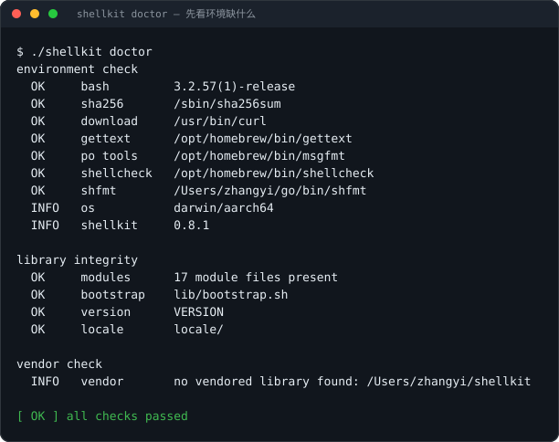
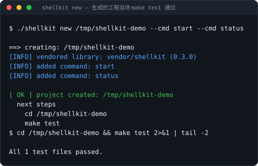
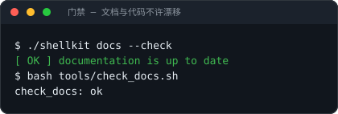

# shellkit

写运维 shell 的起点：一个**约束清晰的 Bash 库**、一个**脚手架生成器**、一套 **CLI 框架**。
目标不是"功能多"，而是**让写出来的脚本又准又一致** —— 日志不会污染 `$(...)`、
失败有固定退出码、同一条命令跑一百遍和跑一遍结果一样。



基线是 **Bash 3.2+**：macOS 自带的 `/bin/bash` 就是 3.2.57，Linux 全系、
macOS 原生 bash、Alpine 的 busybox 之外的主流发行版都能直接跑。

## 和同类项目怎么分工

这个圈子里每个项目只占一格。shellkit 占的是「写运维脚本时的约束」这一格，
并且把**门禁**做到了同类项目都没做的程度：

| 你想解决的问题 | 用谁 | 为什么不自己写 |
|---|---|---|
| 给 Bash 脚本写单元测试 | [bats](https://github.com/bats-core/bats-core) / [bashunit](https://github.com/TypedDevs/bashunit) / [shellspec](https://github.com/shellspec/shellspec) | 现成的断言、mock、报告格式比自研强；shellkit 的 `tests/` 用自己的断言库，但借鉴了这三家的能力清单 |
| 跑命令、写日志、原子改文件、幂等 | **shellkit** | 这四件事在每个工程里各写一遍且写法各异；这里给的是统一约定与固定退出码 |
| 通用脚手架（Python / Node / Go 项目） | [cookiecutter](https://github.com/cookiecutter/cookiecutter) / [copier](https://github.com/copier-org/copier) | 它们不管 Bash 3.2 与运维脚本的约束；shellkit 的 `new` / `upgrade` 走的是同一套变量+清单+钩子机制 |
| Shell 静态检查与格式化 | [shellcheck](https://github.com/koalaman/shellcheck) / [shfmt](https://github.com/mvdan/sh) | 这两个是工具不是库；shellkit 只是在 `make check` 里调它们 |
| 版本管理 / 任务编排 | [mise](https://github.com/jdx/mise) | 那是「装什么工具」的问题，跟「怎么写一个脚本」无关 |
| 曾经想找的「Bash 库 + 脚手架」 | [bash-oo-framework](https://github.com/niieani/bash-oo-framework) | 最接近的先例，2023 年底停更。它堆了 OOP / 类型系统 / 异常 —— shellkit 走的是反方向：扁平函数 + 固定退出码 + 不改调用方的 shell 选项 |

## 先找你自己

站点版（**VuePress 文档站**，中英双语、可搜索、带真跑出来的终端截图）：
https://yi-nology.github.io/shellkit/ —— 中文在 `/`，英文在 `/en/`。

| 你现在的情况 | 从哪进 |
|---|---|
| 想花五分钟判断值不值得用 | 往下读「三十秒」 |
| 已经有脚本在跑，想接库但不想重写 | [docs/MIGRATING.md](docs/MIGRATING.md)：五步渐进，每一步都能单独上线 |
| 手上有具体活：改配置、下载校验、重试、单实例、交互确认 | [docs/COOKBOOK.md](docs/COOKBOOK.md)：25 个场景，每节都是「场景 / 代码 / 为什么」 |
| 想让 AI 替你写 | 根目录的 [AGENTS.md](AGENTS.md)；`shellkit new` 生成的工程也自带一份，写清了这行的坑 |
| 要查某个函数的确切签名和退出码 | [docs/REFERENCE.md](docs/REFERENCE.md)：从源码注释生成，不会和代码漂移 |
| 要给 shellkit 自己出 man 页 | [docs/MAN.md](docs/MAN.md)：`shellkit man` 的用法、生成什么、怎么接进 CI |
| 想先看完整工程长什么样 | [examples/deploy-service](examples/deploy-service)、[examples/fetch-release](examples/fetch-release) |
| 要发版 | [docs/RELEASING.md](docs/RELEASING.md)：一条命令升版本，附带发版后的验收清单 |

## 三十秒

```bash
git clone https://github.com/yi-nology/shellkit.git
cd shellkit
./shellkit doctor                       # 先看环境缺什么，缺了也不影响核心功能
./shellkit new /tmp/shellkit-demo --cmd start --cmd status
cd /tmp/shellkit-demo && make test
```



生成的结构：

```text
shellkit-demo/
├─ bin/shellkit-demo      入口：定位自身 → 加载库与应用 → cli_run
├─ lib/app.sh             装配层：配置路径 + 加载 commands/*.sh
├─ commands/start.sh      每个子命令一个文件，末尾一行 cli_cmd 注册自己
├─ config.example
├─ tests/{run.sh,test_helper.sh,test_smoke.sh}
├─ vendor/shellkit/       随工程走的库副本，不依赖本机装过 shellkit
├─ Makefile               test / lint / fmt
├─ AGENTS.md              给 AI 的约束：禁用语法表 + 任务落点表 + 自检清单
└─ .shellcheckrc
```

**加一个子命令** = 复制 `commands/start.sh` 改名，改函数名和 `cli_cmd` 那一行。
分发器不用动：`cli_run` 用 `declare -F` 动态找 `cmd_<name>`，命令名带短横也对得上
（`install-self` → `cmd_install_self`）。

## 一键安装

```bash
curl -fsSL https://github.com/yi-nology/shellkit/releases/latest/download/install.sh | bash
```

默认装到 `/usr/local`；没有写权限就退到 `~/.local`。要自己指定：

```bash
curl -fsSL .../install.sh | PREFIX="$HOME/.local" bash   # 换目录
curl -fsSL .../install.sh | VERSION=0.13.0 bash           # 钉版本
./install.sh --prefix /opt/shellkit                     # 在检出目录里直接跑，装当前工作树
```

这个地址是 release 资产（`releases/latest/download/install.sh`），不是 `raw.githubusercontent.com` ——
后者在部分网络会被重置，而仓库地址又是固定的，所以网页和 README 都不用 raw。

脚本自己不往目标目录放任何文件：取版本号 → 下载 tar.gz 与 `SHA256SUMS` → 校验 → 交给包内自带的
`shellkit install-self`。**sha256 对不上就 `exit 5`，一个字节都不落地**。

手动装（已经 clone 下来时）：

```bash
./shellkit install-self                    # 默认 /usr/local
./shellkit install-self --prefix ~/.local  # 没有 root 就装到自己的目录
```

## 更新与卸载

```bash
shellkit update --check     # 只比对版本；stdout 只给版本号，可直接进脚本
shellkit update             # 更新到最新 release，校验 sha256 才装
shellkit update --from pkg.tar.gz --sha256 SUM   # 离线或内网：指定本地包
shellkit uninstall-self     # 按 MANIFEST 删干净
```

卸载不猜：安装时把真实落盘的文件写成 `PREFIX/share/shellkit/MANIFEST`，卸载只删清单里列出的
相对路径（`../` 一律跳过并告警）；没有清单就报错退出（退出码 3），交给人决定。

## 不装也能用

```bash
git clone https://github.com/yi-nology/shellkit.git
cd shellkit && ./shellkit new /tmp/demo --cmd start
```

`./shellkit` 本身就是完整 CLI；`shellkit new` 默认把库拷进工程（`vendor/shellkit`），
所以生成的工程不依赖本机装没装过 shellkit。

## 接进已有项目

不用先重写。已经能跑的脚本，一条命令把库镜像进去：

```bash
cd /path/to/your-project
shellkit vendor .            # 同步 lib/ + locale/ + templates/ + tests/ + CLI 到 vendor/shellkit
shellkit vendor . --check     # 只比对（逐字节 diff），漂移返回 5，适合放进 CI
```

副本自带 CLI 与模板，所以拷到一台没装 shellkit 的机器上，工程仍然能离线升级：
`./vendor/shellkit/shellkit upgrade .`

脚本顶部一行接入，然后在 [docs/MIGRATING.md](docs/MIGRATING.md) 里按顺序做五件事：
先杀 stdout 污染 → 配置读写 → 交互 → CLI 框架 → 测试。

```bash
. "$(cd "$(dirname "$0")/.." && pwd)/vendor/shellkit/lib/bootstrap.sh"
```

只想先要测试能力？把 `tests/test_helper.sh` + `tests/run.sh` 两个文件拷过去即可，零依赖。

## 直接用库

`lib/bootstrap.sh` 是唯一入口，一次性按拓扑序加载全部模块：

```bash
#!/usr/bin/env bash
set -euo pipefail

. ./vendor/shellkit/lib/bootstrap.sh

require_bash 3 2                  || exit $?
require_cmd curl sha256sum        || exit $?

conf_init ./config                || exit $?
port=$(conf_get_any PORT 8080)    # 环境变量 PORT > config 里的 PORT > 8080

log_info "starting on port $port"     # 走 stderr，所以上面那行永远是干净的
```

只想要其中几个模块时，用 `SHELLKIT_MODULES` 点名 —— 依赖会自动带上：

```bash
SHELLKIT_MODULES="log fs" . ./vendor/shellkit/lib/bootstrap.sh
# 实际加载：i18n log error trap fs（i18n 恒定加载，它是 _t 的提供者）
```

不设这个变量就是全量加载，行为与以前逐字一致。

## 五条硬约定

这五条是"准"的来源，不是风格偏好：

1. **stdout 只给数据，日志一律 stderr。** 否则 `$(...)` 会混进 `[INFO]`，调用方拿到脏值。
2. **出参用 `printf -v "$var"`，函数不直接改调用方变量。** Bash 3.2 没有 nameref，
   这是唯一在 3.2 上可靠的"返回值"通道。
3. **取值优先级：显式参数 > 环境变量 > 配置文件 > 默认值。** 由 `conf_get_any` 统一实现，
   不在各脚本里各写一遍。
4. **写文件必原子**：临时文件 + `mv -f`，配置类再叠 `chmod 600`
   （`fs_atomic_write`、`conf_set`）。中断不会留下半个文件。
5. **库不改变调用方的 shell 选项，也不改 cwd。** `set -euo pipefail` 只由你的入口脚本开。

## 模块

| 模块 | 关键函数 | 说明 |
|---|---|---|
| `error` | `die` `fail` `require_cmd` `require_root` `require_file` `require_bash` | 失败即返回既定退出码 |
| `i18n` | `_t` `_tn` | msgid 英文，缺 gettext 时原样输出 |
| `log` | `log_info` `log_ok` `log_warn` `log_error` `log_debug` `log_section` | 全部 stderr，彩色可关 |
| `str` | `str_trim` `str_lower` `str_upper` `str_contains` `str_starts_with` `str_ends_with` `str_repeat` | 3.2 没有大小写变换，用 `tr` 兜底 |
| `validate` | `validate_*`（not_empty / single_line / key / port / ip / version / abs_path / url / enum） | 失败原因写 `SK_VALIDATE_ERR` |
| `fs` | `fs_atomic_write` `fs_backup` `fs_ensure_dir` `fs_tmp_init` `fs_ensure_line` `fs_ensure_block` `fs_ensure_symlink` | 原子写；备份按名升序保留最新 N 份；`ensure_*` 幂等改文件 |
| `os` | `os_name` `os_arch` `os_is_root` `os_has_cmd` `os_pkg_*` `os_sed_i` `os_md5` `os_sha256` | Darwin/Linux 差异只在这里 |
| `trap` | `trap_push` `trap_pop` `trap_cleanup` `trap_install` `trap_list` | 清理栈：LIFO、幂等、退出码保真、链式保留已有 EXIT trap |
| `run` | `run` | 跑命令失败即 `die`（消息带命令原文与退出码）；`SHELLKIT_DRY_RUN=1` 只打印 |
| `retry` | `retry` | 退避重试；用法错与校验失败默认不重试 |
| `lock` | `lock_acquire` `lock_release` `lock_held` | mkdir 原子锁（macOS 没有 flock），拿到即挂进清理栈 |
| `net` | `net_download` `net_verify` `net_wait_port` `net_wait_http` | 下载带 sha256 缓存校验与镜像回退 |
| `http` | `net_request` `net_json` `net_escape_json` | 发请求：状态码、响应体、响应头分开给；JSON 交给 jq / python3 解析 |
| `config` | `conf_init` `conf_get` `conf_get_any` `conf_has` `conf_set` `conf_unset` `conf_keys` `conf_load_dotenv` `conf_source` | `KEY=VALUE` 与 dotenv；值未变不写盘 |
| `scaffold` | `scaffold_vars_set` `scaffold_vars_get` `scaffold_manifest_read` `scaffold_render` | 模板变量渲染、生成物清单、生成前后钩子 |
| `prompt` | `ask` `ask_yn` `ask_choice` `confirm` | 超时回退默认值；EOF 与超时区分处理 |
| `cli` | `cli_group` `cli_cmd` `cli_run` `cli_opt` `cli_opts` `cli_completion_script` | 注册即生效，`declare -F` 动态分发 |
| `man` | `man_page` `man_module_page` `man_write_all` `man_modules` `man_count_functions` | 从注册表与函数注释生成 man page，不另维护清单 |

### 退出码

| 码 | 含义 |
|---|---|
| 0 | `SK_OK` |
| 1 | `SK_ERR` 一般错误 |
| 2 | `SK_USAGE` 用法错 |
| 3 | `SK_PRECOND` 前置条件不满足（缺命令、非 root、非交互却没默认值…） |
| 4 | `SK_NET` 网络失败 |
| 5 | `SK_VERIFY` 校验失败（sha256 不匹配、文档与代码不一致…） |

返回码就是接口的一部分，别用 `exit 1` 糊弄所有失败：调用方靠它决定重试还是不重试。

### 环境变量

`SHELLKIT_DEBUG=1`、`SHELLKIT_COLOR=auto|always|never`、`SHELLKIT_NONINTERACTIVE=1`
（等价 `-y`）、`SHELLKIT_TMP_KEEP=1`、`SHELLKIT_NO_GETTEXT=1`、
`SHELLKIT_MIRROR_FROM`/`SHELLKIT_MIRROR_TO`（下载源镜像前缀替换）。

`SHELLKIT_DRY_RUN=1`（`run` 只打印不执行）、
`SHELLKIT_RETRY_DELAY`/`SHELLKIT_RETRY_BACKOFF`/`SHELLKIT_RETRY_MAX_DELAY`/`SHELLKIT_RETRY_ON`、
`SHELLKIT_LOCK_DIR`（默认 `${TMPDIR:-/tmp}`）、`SHELLKIT_LOCK_STALE`（秒，超时视为僵锁）。

`SHELLKIT_LOG_LEVEL=debug|info|warn|error`（默认 info）、`SHELLKIT_LOG_FORMAT=text|json`（默认 text）、
`SHELLKIT_LOG_FILE=PATH`（追加写日志文件）。默认行为与以前完全一样，不设这三个变量就不用管。

## 清理、幂等、重试、单实例

这四件事在运维脚本里天天要写，以前每个工程各写一遍且写法各异：

```bash
trap_push 'rm -rf "$workdir"'   # LIFO；退出/INT/TERM/HUP 都会跑；单个失败不中断其余
trap_install                    # 链式保留你已有的 EXIT trap，幂等

run systemctl restart nginx     # 失败即 die，消息含命令原文 + 退出码
run --no-die systemctl is-active nginx   # 只返回码，可以在 if / || 里判断
retry 5 curl -fsS "$url" -o x   # 默认 1s 起、指数退避 2x、上限 30s

lock_acquire deploy 30          # mkdir 原子锁；超时返回 SK_PRECOND
                                # 拿到即进清理栈，脚本退出自动释放
```

改文件不想写成「删了重加」：

```bash
fs_ensure_line /etc/hosts '10.0.0.5 db'   # 没有才追加；有则一字不动
fs_ensure_block /etc/ssh/sshd_config SSHCFG 'Port 2222' 'PermitRootLogin no'
fs_ensure_symlink /usr/local/bin/tool /opt/tool/bin/tool
```

`ensure_*` 全部走原子写（临时文件 + `mv -f`），且用 `cp -p` 保住原文件权限 ——
直接 `echo >>` 遇到权限 600 的文件会被静默改成 644。

## CLI 框架

```bash
cli_group "运维"
cli_cmd deploy "部署服务" "deploy [--force] <target>"
cli_cmd status "查看状态"

cmd_deploy() {
  local force=""
  local -a rest

  cli_opt_init
  cli_opt force --force -f        # 布尔开关
  cli_opts "$@" || return $?      # 剩下的位置参数在 SK_OPTS_LEFT
  local target="${SK_OPTS_LEFT[0]:-}"
  [ -n "$target" ] || { log_error "缺 target"; return "$SK_USAGE"; }
  log_info "deploying $target"
}

cli_run "$@"
```

错误只报一次：`log_error` 打印一次并记进 `SK_ERRMSG`（最后一条错误），不会重复刷屏。
未知命令按前缀给候选（`Did you mean: deploy`）。

## 脚手架的演化

`new` 只负责第一次。工程交付之后怎么跟上库和模板的改进，是脚手架真正值钱的地方：

```bash
shellkit new ./ops-tool --cmd deploy --cmd status     # 第一次
shellkit upgrade ./ops-tool --check                   # 只看会改什么，不落盘
shellkit upgrade ./ops-tool                           # 落盘
```

`new` 会在工程里留一份 `.shellkit-manifest`（工程名、模板版本、每个文件的指纹），
`upgrade` 靠它判断哪些文件可以安全重放、哪些被你改过 —— 改过的**跳过并告警**，
不会把你的修改覆盖掉。

模板变量写在 `templates/template.config` 里（`KEY=VALUE` + 默认值），
也可以在命令行覆盖：

```bash
shellkit new ./ops-tool --set SERVICE_NAME=api --set SERVICE_PORT=8080
```

生成前后可以挂钩子（`templates/template.hooks.d/pre`、`post`，各是一段可执行 shell）：
`git init`、装依赖、拉 CI 模板都放这里。

用别人（或自己）的模板：

```bash
shellkit new ./ops-tool --template ~/my-templates/service
```

## 命令补全

```bash
shellkit completion bash > /etc/bash_completion.d/shellkit
shellkit completion zsh  > "${fpath[1]}/_shellkit"
```

子命令列表从注册表生成 —— 加了 `cli_cmd` 之后重新生成一次就行，不用维护第二份清单。

## 国际化

msgid 一律英文，译文放 `locale/<lang>/LC_MESSAGES/shellkit.po`：

```bash
bash po/messages.sh     # xgettext → msgmerge → msgfmt，产出 .mo
```

自带 `zh_CN`、`zh_Hant`，`locale/en` 的 msgstr 留空回退英文。
**没装 gettext 不会失败**，只是输出英文。

## 测试输出格式

CI 要的是「哪个用例挂了」，不是「哪个文件挂了」。执行器有三种格式：

```bash
bash tests/run.sh                    # plain（默认，行为与旧版逐字一致）
bash tests/run.sh --format tap       # TAP 13，测试报告工具直接吃
bash tests/run.sh --format junit      # JUnit XML，GitHub Actions / Jenkins 收
bash tests/run.sh --jobs 4           # 并行（每个文件一个独立临时目录）
bash tests/run.sh --filter '*fs*'    # 只跑文件名匹配的文件
bash tests/run.sh --list             # 只列出将要跑的文件
```

`--filter` 收的是 shell 通配符；一个都没匹配上时退出码是 2 并列出可用文件，不会假绿。

用例粒度靠测试文件里的 `# CASE: 标题` 注释切分；没有 `CASE` 标记的文件退化成
「文件级一条用例」。**「有失败但报告说全过」不可能发生** —— 三种格式都会在有失败时
返回非 0，这条不变量由 `tests/test_runner.sh` 守着（它把真的执行器复制到假仓库里，
用受控的失败用例去验每种格式）。

## 文档与门禁

API 文档从源码注释生成，不手写：

```bash
shellkit docs            # 重新生成 REFERENCE.md / AGENTS.md / 模板 AGENTS.md / SKILL.md
shellkit docs --check    # 只校验是否最新，过期返回 5
```

约定是「注释块首行即摘要」，返回码用 `@exitcode` 写明：

```bash
# 下载到指定路径，带 sha256 校验与镜像回退。
# @param 1  目标 URL
# @param 2  保存路径
# @param 3  sha256（可选）
# @exitcode 0 下载成功（带 SHA256 时校验通过）
# @exitcode 4 下载失败
# @exitcode 5 校验和不匹配
net_download() {
  : # 实现见 lib/core/net.sh
}
```

**每个公开函数都必须写明返回码**，`make check` 会查 —— 注释块与函数之间也不能有空行，
空行会让整段注释在 API 参考里消失。

给 AI 看的三份文档（本仓库的 `AGENTS.md`、模板工程的 `AGENTS.md`、可安装的 `skills/shellkit/SKILL.md`）
都是同一条真相源 `docs/ai/contract.md` 拼出来的，改一处三处同时更新 —— 三份手写必然漂移。



门禁有两层，都会拦住「文档写着、代码里没有」：

```bash
make check     # syntax + test + lint + module-order-check + check-exitcode-docs
               # + docs-check + check-docs + cookbook-check + messages-check
               # + examples + fmt
```

- `docs-check`：公开函数缺注释、生成物与源码不一致 ⇒ 红。
- `check-docs`：所有 markdown 的 bash 代码块必须过 `bash -n`，块里出现的函数名必须真实存在于
  `docs/REFERENCE.md` ⇒ 红。所以 README 里的例子改名后会立刻失败，而不是悄悄烂掉。
- `module-order-check`：某个模块调用了还没加载的模块的函数 ⇒ 红。
- `check-exitcode-docs`：公开函数没写明返回码，或注释块与函数之间有空行 ⇒ 红。
  「返回码就是接口的一部分」这句话得有门禁兑现，否则接口是残的。
- `cookbook-check`：README 与站点首页里手写的「N 个场景」必须与 Cookbook 实际场景数一致 ⇒ 红。
  手抄的数字必然过期，过期就得有人记得改 —— 这道门替那个人。

## 示例工程

两个能直接跑的完整工程，演示的是**装配**，不是把库再实现一遍：

- [examples/deploy-service](examples/deploy-service)：幂等安装 systemd 单元。
  锁 + 原子写 + 幂等 + stdout 只给数据，落点用 `DEPLOY_ROOT` 注入所以不碰真实系统。
- [examples/fetch-release](examples/fetch-release)：下载、校验、原子切换版本。
  `net_download` 的缓存校验 + `retry` + 符号链接切换；上游用 `file://`，测试完全离线。

测试全程走真实二进制，不 source 内部函数：

```bash
bash examples/deploy-service/tests/test_deploy.sh
bash examples/fetch-release/tests/test_fetch.sh
```

## Bash 3.2 兼容

为了在 macOS 原生 bash 上跑，全库**不使用**：

关联数组（`declare -A`）、`local -n`/nameref、`${var^^}`/`${var,,}`、`mapfile`/`readarray`、
`[[ -v var ]]`、空数组展开（3.2 在 `set -u` 下会报错）。

替代手法：子命令用 `declare -F` 动态分发；出参用 `printf -v`；大小写用 `tr`；
数组追加用 `arr[${#arr[@]}]=x`；遍历可能为空的数组一律写
`${arr[@]+"${arr[@]}"}`，否则 3.2 在 `set -u` 下直接报 unbound variable。

完整对照表在 [AGENTS.md](AGENTS.md)。

## 目录

```text
shellkit                  生成器入口（也 source 自己的库）
lib/bootstrap.sh          唯一入口，按 lib/modules.txt 的顺序加载
                          SHELLKIT_MODULES="log fs" 只加载这两个模块和它们的传递依赖
lib/modules.txt           模块清单的唯一真相源：模块名 + 它依赖的模块
lib/core/*.sh             23 个模块
templates/                shellkit new 的模板
tests/                    断言库 + 逐文件执行器 + 每个模块一个测试
tools/                    shdoc.awk 渲染 / comment_coverage.awk 查漏 / check_docs.sh 门禁 / term_shot.py 截图
examples/                 两个能直接跑的完整工程
po/messages.sh            msgid 抽取与 .mo 编译
locale/{en,zh_CN,zh_Hant}
docs/ai/                  AI 契约的真相源（三份产物由它拼出）
docs/shots/               截图：.shot 是真命令，.svg 是真输出
docs/superpowers/specs/   设计文档（决策记录）
site/                     VuePress 2 文档站（手写页 + 从 docs/ 同步的生成页）
tools/site_sync.sh        把 docs/ 投影成站点页面（cookbook / 迁移 / 发版 / API 参考）
tools/site_links.sh       构建产物上的链接门禁（主题自带的 links-check 不会让构建失败）
```

截图不是画的：`docs/shots/*.shot` 里每行 `$` 开头的都是要真跑的命令，
`make shots` 执行它们并把真实输出渲染成 SVG —— 所以版本号、路径、退出码都是当时的真值。

## 许可

MIT，见 [LICENSE](LICENSE)。

设计骨架参考自 [jumpserver/installer](https://github.com/jumpserver/installer)（GPLv3），
原署名保留在 [NOTICE](NOTICE) 里。shellkit 的代码是独立实现 —— 与上游逐行比对，
代码行零重合，未复制上游代码。

选 MIT 而不是 GPL-3.0，是因为这个库的定位就是**被别人 vendor 走**：下游把
`lib/` 拷进自己的工程。GPL-3.0 的传染性会把下游的闭源产品也拖进去，
这对库来说是硬约束。作为库被使用的同类项目（bash-oo-framework、bats、
shellspec、cookiecutter、copier、mise）全部用 MIT/BSD/Apache。
